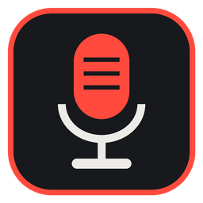

# Podcast Recorder

A podcast recorder that runs entirely in your web browser. No install, no account, and your audio never leaves your computer.

**▶ Use it here: https://harleyloft47-king.github.io/podcast-recorder/**

Open the link in Chrome, Edge, Firefox or Safari, click **Enable microphone**, allow the mic, and press **Record**.

## Features

- **Lossless recording** to 16-bit WAV, saved in the browser as you go, so a crash or closed tab doesn't lose a take
- **MP3 export** for publishing (96 kbps mono / 128 kbps stereo)
- **✨ Polish:** one click to reach podcast loudness (−16 LUFS stereo / −19 LUFS mono), gentle compression, a −1 dB peak limiter, and silence trimmed from the start and end. Creates a new take and keeps the original.
- **✂ Trim:** drag handles on a waveform to cut the start and end
- **Soundboard:** built-in intro, outro, transition and sting sounds, plus your own sounds. Rename, replace or delete pads; keys 1–9 play them; everything you play is recorded
- **Co-host mic:** record two USB mics on separate tracks (plus a soundboard track), then download each person's track or a mix
- **Markers** (press M) that export as an Audacity labels file
- **Notes** for each take: show notes, guest names, links
- **3-2-1 countdown**, **length goal** with a chime, **headphone monitoring**, and live level meters with a clip light

## Keyboard shortcuts

| Key | Action |
| --- | --- |
| Space | Record / pause / resume |
| M | Drop a marker |
| S | Stop and save the take |
| 1–9 | Play soundboard pads |

## Tips

- Wear headphones when using the soundboard or "Hear myself", so the mic doesn't pick the sound up again.
- Aim for level-meter peaks between −12 and −6 dB.
- Takes are stored in your browser for this site. Download the ones you want to keep, especially before clearing browsing data.
- MP3 export loads an encoder ([lamejs](https://github.com/zhuker/lamejs)) from a CDN the first time it's used, so it needs an internet connection.

## Run it offline

`index.html` is the whole app. Download it and open it in a browser.
